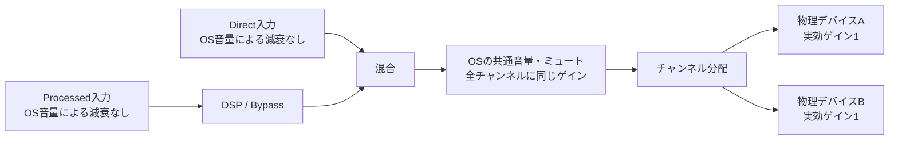

# plan2 マルチデバイス出力の共通音量制御

2026-11-01の検討内容を保存する。調査基準は`develop`の`8da0312`。対象はPipeTune 2.16.0とEffeTune DSP 2.16.0である。実装前の計画を原本とし、実装時の判断と検証結果は末尾へ追記する。

## 背景と目的

マルチデバイス出力の音声レベルが、シングルデバイス出力より小さいとの報告があった。稼働環境を調べると、PipeTuneの全体音量は100%だった。一方、物理出力には機器ごとの減衰が残っていた。

| 出力デバイス | 観測した線形ゲイン | dB換算 | 確認できた出所 |
| --- | --- | --- | --- |
| TX | 約0.00351554 | 約−49.1 dB | WirePlumberの保存値と一致 |
| SMSL | 約0.0639971 | 約−23.9 dB | 保存値がなく、WirePlumberの既定値とほぼ一致 |

SMSLへの既定値の適用は、観測値と設定からの推定である。TXの値がいつ、どの操作で保存されたかは分からない。単一モードとの同一条件での音声比較は、この調査ではまだ実施していない。

この環境のWirePlumberは0.4.17である。物理出力の音量はデバイスと出力端子ごとに保存・復元される。保存値がない出力には、既定で`0.4³ = 0.064`の線形ゲインが適用される。これは通常の音量表示で40%相当になる。[WirePlumber 0.4.17の経路管理](https://github.com/PipeWire/wireplumber/blob/0.4.17/src/scripts/policy-device-routes.lua)、[デバイスの既定設定](https://github.com/PipeWire/wireplumber/blob/0.4.17/src/config/main.lua.d/40-device-defaults.lua)

複数モードでは、Ubuntuのsoundパネルから物理出力の音量を操作できない。利用者にはPipeTuneの音量だけが見えるため、物理側の減衰を残す構成では、表示された音量と実際の制御範囲が一致しない。

本計画では、OSの出力音量を操作すれば、PipeTuneから各デバイスへ送る音声を期待どおりに調整できるようにする。隠れた物理音量の手動調整を利用者へ求めない。

## 用語と対象範囲

ProcessedはEffeTuneのDSP処理を通るステレオ入力である。DirectはDSPを通らない多チャンネル入力を指す。BypassではProcessedのDSP処理を省略する。Directの経路はBypassの切り替え対象に含めない。

ゲインは音声の振幅に掛ける倍率である。線形ゲイン1は増減なし、0は無音を表す。本書では、混合後の全チャンネルへ同じ倍率を掛ける音量を共通音量と呼ぶ。共通音量にはミュートも含める。

「入力を減衰しない」とは、OSの出力音量による減衰をPipeTuneへの入力へ掛けないことを意味する。アプリ自身の音量、アプリごとの音量設定、プリセット内のVolumeなどは、それぞれの機能として扱う。これらを強制的に最大値へ変更しない。

対象とする物理ゲインは、PipeWireが報告し制御できる実効ゲインである。機器のハードウェア音量とソフトウェア音量を含む。`channelVolumes`に`softVolumes`を重ねて掛けてはならない。後者は前者のうちソフトウェアで適用する部分を表す。[SPA音量パラメーター](https://docs.pipewire.org/group__spa__param.html)

機器の独立したアナログつまみや、スピーカーごとの音響感度を揃える機能は対象外とする。全チャンネルへ同じ減衰率を適用することと、各スピーカーの音圧を同じにすることは区別する。

## モードごとの音声仕様

### シングルモード

アプリケーションの音声を、OSの出力音量によって減衰させずにPipeTuneへ入力する。DSPまたはBypassを通した後、OSが指定する出力音量とミュートを物理出力側で適用する。

現在の単一モードの動作を維持する。複数モード用の共通音量を追加で掛けたり、物理出力をゲイン1へ固定したりしない。

### マルチモード

ProcessedとDirectの両入力に、OSの出力音量による減衰を掛けない。ProcessedのDSP出力とDirectを混合し、その結果に共通音量を一度だけ適用する。その後、保存されたチャンネル割り当てに従って各デバイスへ分配する。

あるチャンネルのProcessed出力を`p`、Direct入力を`d`、共通ゲインを`g`とすると、出力は`g × (p + d)`となる。ミュート中は出力を0にする。片方だけを再生する場合も同じ規則を使う。

各チャンネルの音声内容やDSPによるレベル差は維持する。デバイス数やチャンネル数によってゲインを割らない。混合時の自動正規化やリミッターの追加も、この計画には含めない。

OSが示す音量の百分率を、そのまま線形ゲインとして扱わない。OSからPipeWireへ渡された音量値を使い、単一モードと音量目盛りの解釈を揃える。

## 現行実装との違い

| 対象 | 現行実装 | 変更後 |
| --- | --- | --- |
| Processedの音量 | DSP後段、Directとの混合前に適用 | 混合後の共通音量として適用 |
| Directの音量 | Direct専用の音量として適用 | 共通音量へ統合し、入力側は減衰なし |
| OS上の音量表示 | ProcessedとDirectが別々の値を持つ | 両方に同じ共通音量とミュートを表示 |
| 物理出力のゲイン | 現在値を読み取って報告する | 複数モードで選択中の出力を実効ゲイン1へ管理 |
| 単一モードへ戻る操作 | 物理音量を変更していないため、そのまま利用 | 退避した物理音量とミュートを復元してOSへ制御を戻す |

Processedの音量処理は[pipewire_pipeline.cpp](../../../pipetune/src/pipewire_pipeline.cpp)にある。`publishMasterVolume`はOSに見せる音量と、入力へ実際に掛ける音量を分離している。`outputProcess`では`masterOutputGain`をProcessedの各チャンネルへ掛けている。

Directと分配ノードは[output_distribution.cpp](../../../pipetune/src/output_distribution.cpp)で構成する。DirectにはPipeWireのloopbackモジュールを使っている。両入力は既存の`distribution`ノードへ合流しており、分配と遅延補償にはcombine-streamモジュールを使用している。

物理音量の取得は[pipewire_output_inventory.cpp](../../../pipetune/src/pipewire_output_inventory.cpp)、共通音量の保存と出力の可視性は[wireplumber_visibility.cpp](../../../pipetune/src/wireplumber_visibility.cpp)で扱う。既存の音量保存はProcessedを対象としており、Directとの共通化には保存・復元の整理が必要になる。

## 変更方針

### OS上のProcessedとDirectを一つの音量へ結び付ける

ProcessedとDirectは、アプリケーションが音声の経路を選ぶための入力先として残す。OS上でどちらの音量・ミュートを操作しても、同じ共通状態を更新する。読み戻した値も一致させる。

入力先の切り替えだけでは共通音量を変更しない。OSへ通知した更新を新たな利用者操作として受け取り、更新が循環することも防ぐ。Processedは2チャンネル、Directは構成に応じたチャンネル数を持つが、共通音量は一つの値として管理する。チャンネルごとに異なる値を受け取った場合の扱いは、全チャンネルを同じ減衰率にする契約に沿って定める。

共通音量とミュートの保存元を一つにする。Directの従来の保存値や、再作成されたノードの初期値で、稼働中の共通状態を上書きしない。現在の「新規起動時に復元し、動作中はデーモンの値を優先する」という方針を共通状態へ適用する。

### 入力ゲインと共通音量を分離する

Processedで使っている分離方法をDirectにも適用する。OSへ表示する音量・ミュートは共通状態を表し、入力音声に掛ける実効ゲインは1に保つ。ミュートも混合後へ適用するため、入力側のミュートが残らないようにする。

現在のDirectは標準loopbackモジュールに任せている。表示値の同期だけで入力側の減衰やミュートを抑えられるとは扱わない。PipeTuneが制御要求を受け取り、入力の処理値と分けて扱える構成を第1段階で確認する。[Loopbackの仕様](https://docs.pipewire.org/page_module_loopback.html)、[PipeWire 1.0.5のloopback実装](https://github.com/PipeWire/pipewire/blob/1.0.5/src/modules/module-loopback.c)

公開されているStream APIには、パラメーター変更時にアダプターへ渡す値を調整する機能がある。実装では公式文書とヘッダーのAPIコメントの両方を確認する。外部コードや内部用APIへ依存する変更は行わない。[Stream API](https://docs.pipewire.org/group__pw__stream.html)、[PipeWire 1.0.5のstream.h](https://github.com/PipeWire/pipewire/blob/1.0.5/src/pipewire/stream.h)

### 混合後に一度だけ共通音量を適用する

既存の`distribution`ノードを共通音量の適用先とする方法を第一候補とする。Processed専用の減衰とDirect専用の減衰は廃止する。各デバイスへの分配ストリームにも独立した減衰を残さない。

combine-streamは仮想出力から複数の出力先へ音声を分配し、チャンネルの対応付けと遅延補償を扱う。[Combine Streamの仕様](https://docs.pipewire.org/page_module_combine_stream.html)、[PipeWire 1.0.5のcombine-stream実装](https://github.com/PipeWire/pipewire/blob/1.0.5/src/modules/module-combine-stream.c)

以下では、サンプル値として観測するデジタル音声をPCMと呼ぶ。現行構成を利用しながら、混合結果に対する音量適用を実際のPCMで確認する。

分配ノードの再作成時にも共通状態を適用する。音量が確定する前に初期値のまま再生を始めない。DSP出力と混合後出力のメーターについても、音量を掛ける位置との関係を確認し、利用者向けの説明と揃える。

### 選択中の物理出力を管理する

複数モードで選択している出力について、制御可能な実効ゲインを1、ミュートを解除した状態にする。単に機器のハードウェアつまみを最大へ動かすこととは区別する。物理側の値に応じた逆数をDSP側へ掛けて帳尻を合わせる方式は採らない。ゼロゲインやミュートをその方法で解消することはできない。

制御を始める前に、物理出力の音量とミュートを退避する。デバイスと出力経路を識別して保存し、再接続で変わるPipeWireの数値IDだけで復元先を決めない。出力選択の解除、単一モードへの復帰、通常終了時には、その出力の退避値を復元する。選択していないデバイスや入力側の音量は変更しない。

初回の設定だけでは、WirePlumberによる保存値の復元に対応できない。再接続、プロファイル変更、WirePlumber再起動でも、対象出力の音量を管理する。標準の保存・復元処理との担当を明確にし、設定の上書きを繰り返す構成にしない。複数モードのために一時適用したゲイン1を、単一モード用の退避値として保存し直してはならない。

異常終了時にも元の物理音量へ戻せるよう、復旧に必要な情報を保持する。既存のWirePlumberポリシーによる可視性と既定出力の復旧に、物理音量の復元を組み込む。物理出力をOSへ戻す順序も検証対象とする。[WirePlumberのState API](https://pipewire.pages.freedesktop.org/wireplumber/scripting/lua_api/lua_state_api.html)

音量変更に失敗した場合や、必要な実効ゲインを確認できない場合は、対象と理由を診断に含める。共通音量どおりの出力を確認できていない状態を、適用成功と表示しない。

## 切り替えと復旧

物理出力の減衰を解除する操作と、混合後の共通音量を適用する操作は連携させる。準備中は対象経路の出力を抑え、必要な設定を確認してから再生する。これにより、古い物理減衰だけが先に解除される状態を避ける。

| 場面 | 必要な動作 |
| --- | --- |
| 複数モードの開始 | 物理音量を退避し、共通状態と物理ゲインの適用を確認してから出力する |
| デバイスの追加 | 新しい対象の音量を退避して管理を開始する。既存の共通状態を使う |
| デバイスの選択解除 | 対象への配信を止め、退避した音量とミュートを復元する |
| 切断と再接続 | チャンネル割り当てと共通状態を保持する。再接続先の一致と音量を確認してから再開する |
| プロファイル変更 | 現在の出力経路を確認し、plan1の一括適用・復元と音量管理を整合させる |
| デーモン内の経路再構成 | 稼働中の共通状態を保持し、新しいノードへ適用する |
| デーモンの新規起動 | 保存した共通状態を復元する。復元前に初期音量で再生しない |
| WirePlumber再起動 | 稼働中の共通状態を優先し、物理出力の管理を再開する |
| 単一モードへの復帰・通常終了 | 物理音量の復元とOSへの出力制御の返却を整合させる |
| 異常終了 | WirePlumber側で退避値を復元する。復旧途中の再起動にも対応する |
| 適用・復元の失敗 | 旧状態への復元を試み、復元自体の失敗も利用者へ示す |

共通音量の保存値がない場合の初期値と、モード間で音量を引き継ぐ細則は未確定である。機器ごとに異なる従来の減衰を、一つの共通値ですべて維持することはできない。実装時にこの点を整理し、本計画へ判断を追記する。今回の保存では、初期値を一律100%にするなどの仕様を追加しない。

## 段階的な実装計画

各段階で製品の音声経路を実行できる状態にし、対応するテストで結果を観測する。問題を再現するテストでREDを確認し、修正後のGREENを確認してからコミットする。隔離したPipeWire環境から検証を始める。

### 1 共通音量と混合後の音量適用を実装する

共通音量の初期値、モード間の引き継ぎ、チャンネルごとに異なる音量要求の扱いを整理する。未確定の細則は、この段階で判断を本計画へ追記してから実装する。

物理出力がゲイン1の仮想デバイスを使い、ProcessedとDirectを同時再生できる既存の出力テストを拡張する。両入力の制御値を共通化し、OSの音量変更を入力へ掛けずに混合後へ適用する。Directの制御方法と、分配ノードでの音量適用が成立することも、この段階の実PCMで確認する。

完了条件は、Processed単独、Direct単独、同時再生のすべてで、出力が`g × (p + d)`と一致すること。どちらの公開入力から操作しても、音量とミュートの読み戻しが一致することも含める。DSP入力が音量操作で変わらないことを検証する。

独立した音量機能の廃止には、プロジェクトの機能削除手順を適用する。独立制御がなくなったことを確認するテストでREDを確認し、変更後のGREENで一旦コミットする。その後、削除確認専用のテストを除去して整理する。共通音量の動作を検証する回帰テストは残す。

成果物は、仮想デバイス上で共通音量を操作できる製品経路と回帰テストとする。コミット例は`fix: apply shared output volume after mixing`。

### 2 物理出力の音量管理と通常の復元を統合する

物理出力に異なる保存ゲインやミュートがある状態を再現する。選択中の出力を実効ゲイン1に管理し、元の値の退避と復元を実装する。出力構成の一括適用と連携させ、途中失敗では音声経路と音量の両方を復元する。

完了条件は、変更前の物理ゲインにかかわらず、適用後に隠れた減衰が残らないこと。選択解除、単一モードへの復帰、通常終了で退避値が戻り、入力側と非選択デバイスの設定を維持できることも確認する。制御を拒否するデバイスについては、成功扱いせず診断できることを含める。

成果物は、保存音量のある仮想デバイスでもOSの共通音量で再生できる製品経路と、通常の切り替えを検証するテストとする。コミット例は`fix: manage selected device gains in multiple mode`。

### 3 再接続・再起動・異常終了からの復旧を完成させる

WirePlumberの保存値復元とPipeTuneの物理音量管理を整合させる。切断、プロファイル変更、ノード再作成、デーモン再起動、WirePlumber再起動、異常終了を対象にする。新しい接続先の値で、以前の退避値を誤って上書きしないことも確認する。

完了条件は、共通状態とチャンネル割り当てが所定の範囲で保持・復元されること。再生再開前に音量の適用を確認し、復旧過程で一時的な過大出力や隠れた減衰が出ないことを検証する。PipeTuneが異常終了した場合も、物理音量を復元してOSから通常の操作ができる状態へ戻す。

成果物は、障害から復旧できる音量管理と、終了・復旧を実行するテストとする。コミット例は`fix: restore output volume ownership across restarts`。

### 4 OS画面との整合と全体回帰を確認する

Ubuntuのsoundパネルで、ProcessedとDirectのどちらを選んでも共通音量を操作できることを確認する。表示値、ミュート、物理出力のPCMを照合する。同じアプリ音量とプリセットを使い、単一モードと複数モードの対応する出力を比較する。

既存の音量テストや説明を新しい仕様に合わせて整理する。不要になった処理は削除し、既存コメントは必要に応じて更新する。利用者向け文書は日本語を原本として、他言語にも反映する。一般文書から本計画へのリンクは追加しない。

完了条件は、次節の全項目を検証し、最後のコード変更後に全体テストが成功すること。ビルド警告は分析して対処する。実機での検証範囲と未確認事項を記録し、未確認の項目を完了済みとは扱わない。

コミットは変更内容に応じて`fix:`、`refactor:`、`chore:`、`doc:`へ分ける。

## 検証と最終完了条件

| 検証対象 | 完了条件 |
| --- | --- |
| Processedへの入力 | 共通音量・ミュートの操作で、DSPへ渡す音声のレベルが変わらない |
| Directへの入力 | 共通音量による減衰や入力側のミュートが残らない |
| 混合結果 | 単独再生と同時再生で`g × (p + d)`を満たし、音量を二重に掛けない |
| 全チャンネル | 構成したすべての出力で同じ減衰率を適用し、チャンネル割り当てを維持する |
| OSの音量表示 | ProcessedとDirectの操作・読み戻しが一致し、入力先の切り替えで値が変わらない |
| ミュートと解除 | 両入力を含む混合結果が無音になり、解除後は保持した共通音量へ戻る |
| 物理音量 | 異なる初期ゲインやミュートを持つ選択出力でも、共通音量以外の減衰が残らない |
| 管理の解除 | 選択解除、単一モードへの復帰、終了時に退避した物理音量とミュートを復元する |
| 対象範囲 | 入力側と非選択デバイスの音量・ミュートを変更しない |
| 再接続とプロファイル | 接続先を確認して音量管理を再開し、古い接続IDへ設定しない |
| 再起動と異常終了 | 共通状態と退避値を適切に復元し、復旧中にも過大出力を発生させない |
| 失敗時 | 音量の適用や復元を確認できなければ、対象と理由を示し、成功扱いしない |
| シングルモード | DSPへの入力にOS出力音量を掛けず、物理出力でOS音量を適用する |
| モード間の比較 | 同じ入力・プリセット・対応チャンネル・OS音量で、モード固有の余分な減衰がない |
| 全体回帰 | 最終コードで全体テストが成功し、OS画面と実機での確認結果が記録されている |

既存の[製品出力テスト](../../../pipetune/test/product_output_test.cpp)、[隔離環境の起動スクリプト](../../../pipetune/test/multi-device-output.mjs)、[仮想デバイス](../../../pipetune/test/device_presentation_fixture.c)を活用する。OSの音量操作に使われるPulseAudio経由の制御も確認し、PipeWireへ直接設定するテストだけで完了としない。

ソースコードに特定のプロパティが書かれていることだけでは、動作の検証にならない。入力と出力のPCM、音量の読み戻し、物理出力の報告値、保存と復元の結果を検証する。DSP入力への減衰は、音量で動作点が変わる処理や、DSPが追加した信号も使って検出する。

固定時間の待機を成功条件にしない。制御要求の反映、接続状態、PCMの受信などを根拠に判定する。切り替え中の音量も時系列で検証する。UIの時間的な挙動が問題となった場合は、動画を記録して挙動を検証する。

仮想デバイスで検証した範囲と、実機で検証した範囲を分けて記録する。対応対象のWirePlumber 0.4系と0.5系で保存・復元を確認する。計画と実装に矛盾が見つかった場合は、原因を整理し、計画を見直してから作業を続ける。

## 保存時点の状態

本計画の実装は未着手である。現行コード、稼働環境の読み取り結果、PipeWireとWirePlumberの公開仕様を基に、実現可能な構成として整理した。共通音量へ変更した構成のPCM検証と、Ubuntuのsoundパネルでの動作確認は未実施。

今回の作業はplan2の保存までとする。文書の内容、参照先、Markdown、日本語表現を確認する。計画書はビルド処理の入力ではないため、この文書だけの変更ではビルドと全体テストを実行しない。

## 実装時の判断

2026-11-02、plan2の実装指示に基づいて着手した。初期音量については、利用者の回答により、保存した共通音量がない場合に切り替え前のOS出力音量とミュートを引き継ぐ。保存値がある場合はその値を復元する。単一モードへ戻る際は、各物理デバイスの元の音量とミュートを復元する。

チャンネルごとに異なる音量要求は、従来のProcessedと同様に、最も大きい値へ揃える。ProcessedとDirectの両方にこの値を表示し、全出力チャンネルへ同じゲインを適用する。ミュートだけの要求では、それまでの音量を保持する。

Directは公開Stream APIによる入力・出力ストリームで構成する。入力の音量要求を受け取り、表示値と音声処理値を分離する。分配ノードは初期状態をミュートとし、共通状態が確定してから適用する。DSP出力メーターは共通音量を掛ける前、混合後メーターは掛けた後の音声を示す。

第1段階では、隔離環境の`product-direct`で、Direct側の音量変更後に期待するPCMが得られないことを確認した。変更後は、単独・同時再生、両入力からの操作、チャンネル音量の統一、ミュートだけの変更、96 kHzへの切り替えが成功した。`product-volume`、`product-restart-mute`、`product-source-resume`も成功した。独立音量の削除確認テストは、成功時点でコミットした後に除去し、共通音量の回帰テストを残す。

第2段階では、異なる左右ゲインとミュートを持つ仮想デバイスで、変更前にPCMが期待値へ届かないことを確認した。変更後は、選択出力のゲイン1とミュート解除、切り替え前のOS音量0.25の引き継ぎ、非選択デバイスの維持、通常終了と単一モードでの復元を確認した。ゲイン1への変更を拒否するデバイスでは、適用成功を通知せず、対象名を含む診断を返す。

選択解除のテストでは、ストリームの寿命だけを管理期間とすると、再構成中にも物理音量を復元してしまう問題が見つかった。管理期間の判定を見直し、分配ノードが宣言する出力先と、デーモンの存続を併用する。継続使用するデバイスの退避値は保持し、選択解除の応答は復元を確認してから返す。プロファイル変更時の入力経路の維持も、既存の経路ポリシー付きテストで確認した。

WirePlumberの音量設定は、関数の戻り値だけで成功とみなさない。0.4のLua APIは値を返さないため、設定後のパラメーター通知を確認する。確認できるまで該当する分配ストリームをミュートし、期限内に確認できなければ診断する。[0.4.17のLuaバインディング](https://github.com/PipeWire/wireplumber/blob/0.4.17/modules/module-lua-scripting/api/api.c)

第3段階では、共通ゲイン0.5で再生中の再接続とWirePlumber再起動を検証した。再接続したデバイスの初期ゲインを0.75と0.875へ変えても、再開後のPCMは共通音量に一致し、終了時には最初の0.125と0.25へ戻った。デーモンの強制終了、WirePlumber停止中の強制終了、その後のWirePlumber再起動でも復元を確認した。起動中のPCMが引き継いだOS音量を超えないことも検証している。

単一モードへ戻す際の復元をデバイスが拒否した場合は、デバイス名を含むエラーを返し、出力構成を元の複数モードへ戻す。拒否を解除して終了すると、元の物理音量へ復元できることを確認した。
